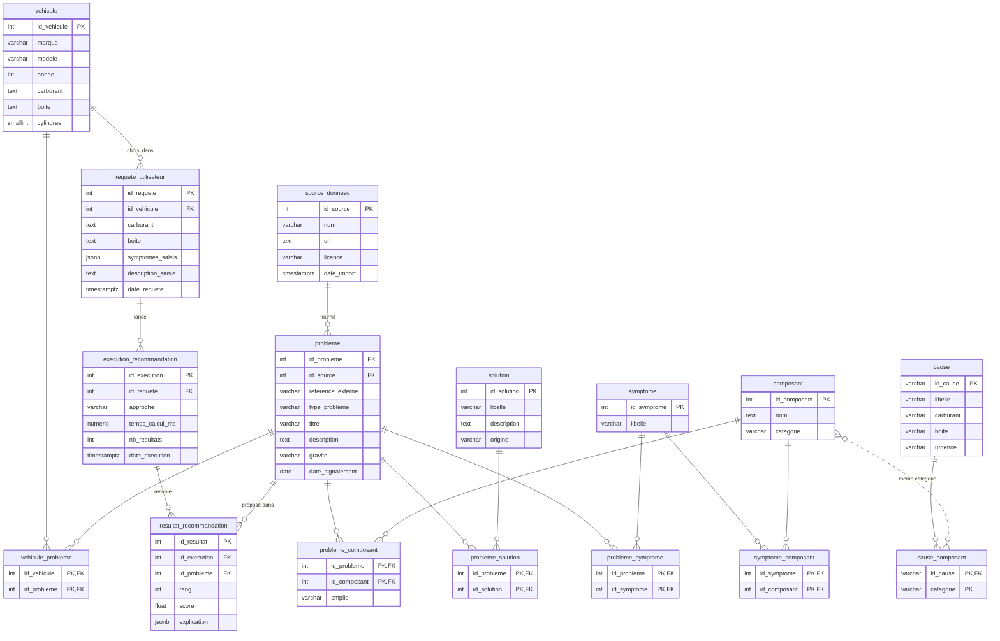

# Schéma entité-association

Diagramme tiré de `bdd/schema.sql` (16 tables et une vue). GitHub l'affiche directement en image.

## Les tables en une phrase

**Données NHTSA**
- `source_donnees` : d'où viennent les données (nom, adresse, licence, date d'import).
- `probleme` : une plainte NHTSA (une par ODINO), avec son texte et sa gravité.
- `vehicule` : un véhicule, identifié par marque, modèle, année, carburant, boîte et cylindres.
- `composant` : un composant NHTSA (`COMPDESC`) et sa catégorie (partie avant le premier « : »).
- `vehicule_probleme` et `probleme_composant` : relient une plainte à son véhicule et à ses composants.

**Contenu métier**
- `cause` : les 15 causes proposées à l'utilisateur (C1 à C15), avec carburant, boîte et urgence.
- `cause_composant` : relie une cause aux catégories de composants. Le lien avec `composant` passe par la valeur de `categorie`, pas par une clé étrangère (une catégorie regroupe plusieurs composants).
- `solution`, `symptome` et leurs tables de liaison (`probleme_solution`, `probleme_symptome`, `symptome_composant`).

**Utilisation de l'application**
- `requete_utilisateur` : ce que l'utilisateur a saisi (véhicule, carburant, boîte, symptômes, description).
- `execution_recommandation` : une exécution d'une approche (heuristique ou embeddings) pour une requête, avec son temps de calcul.
- `resultat_recommandation` : le classement renvoyé par une exécution, avec le score et l'explication du « Pourquoi ».
- La vue `v_metriques_approche` calcule les temps min, max, moyen, médian et p95 par approche (dashboard).
